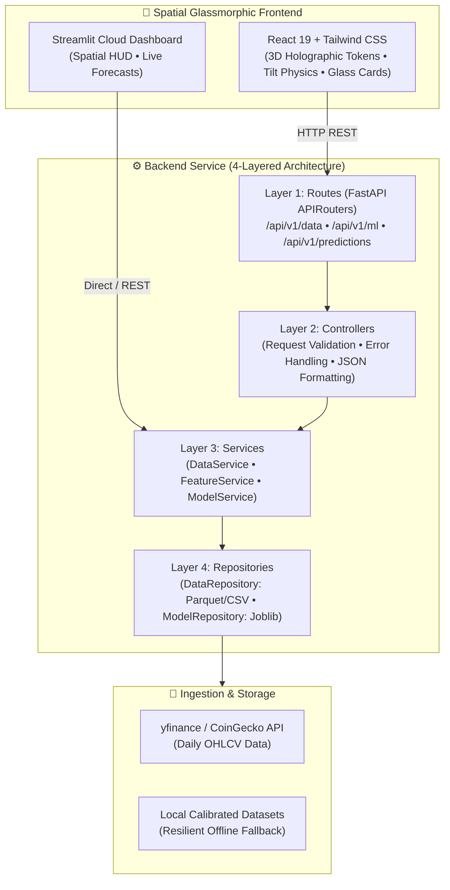

# ⚡ Crypto Trend Predictor (Spatial AI Edition)

An enterprise-grade, portfolio-ready Machine Learning platform that forecasts next-day cryptocurrency price direction (**UP / DOWN**) with **zero lookahead data leakage**, strict time-based splits, honest baseline evaluation, a **4-layer backend architecture**, and an ultra-modern **React + Tailwind CSS 3D Spatial Glassmorphic UI** (plus an interactive **Streamlit dashboard**).

> **⚠️ Disclaimer:** Educational and research portfolio project only. Not financial, trading, or investment advice.

---

## 🏛️ System Architecture

The application is structured into decoupled, production-grade layers:



### Backend 4-Layer Architecture:
1. **Layer 1: Routes (`backend/app/routes/`)**
   - API interface defining endpoint schemas, request parameters, and HTTP methods (`data_routes.py`, `ml_routes.py`, `market.py`).
2. **Layer 2: Controllers (`backend/app/controllers/`)**
   - Request extraction, parameter parsing, error boundaries, and formatted responses (`data_controller.py`, `health_controller.py`).
3. **Layer 3: Services (`backend/app/services/`)**
   - Core business and ML logic:
     - `DataService`: Ingestion, validation (chronological monotonicity, price positivity, gap checking), resilient offline fallback.
     - `FeatureService`: Technical indicators strictly computed with past and present data ($t \le \text{present}$).
     - `ModelService`: Chronological time-series split, training pipeline, evaluation against naive baseline, and inference.
4. **Layer 4: Repositories (`backend/app/repositories/`)**
   - Atomic disk persistence (Parquet & CSV for datasets, Joblib & JSON for trained models and metrics).

---

## 🛡️ Anti-Data-Leakage Design

In time-series modeling, random shuffling causes catastrophic **future lookahead bias**. This project strictly enforces:
- **Strict Chronological Split (`shuffle=False`)**: The model trains on earlier dates (e.g. 80%) and is evaluated exclusively on held-out future dates (20%).
- **Target Formulation**:
  $$\text{Target}_t = \begin{cases} 1 (\text{UP}) & \text{if } \text{Close}_{t+1} > \text{Close}_t \\ 0 (\text{DOWN}) & \text{otherwise} \end{cases}$$
  The target at day $t$ uses the next day's outcome, but features at day $t$ use *only* information available at or before day $t$.
- **Scaler Hygiene**: `StandardScaler` is fit *only* on the training set and applied to the test set via an `sklearn.pipeline.Pipeline`.
- **Warmup Dropping**: Initial rolling indicator warmup rows and the unlabelled final day are safely partitioned.

---

## 📊 Feature Engineering Pipeline

Features are extracted across multiple market dynamics:
- **Horizon Returns**: `return_1d`, `return_3d`, `return_7d` (Percentage price changes).
- **Trend Moving Averages**: `sma_7_ratio`, `sma_14_ratio`, `sma_30_ratio` ($\frac{\text{Close}}{\text{SMA}} - 1$).
- **Momentum (RSI)**: 14-day Wilder's smoothed Relative Strength Index.
- **Volatility**: 7-day and 14-day rolling standard deviations of returns.
- **Volume Momentum**: `volume_ratio_7d` ($\frac{\text{Volume}}{\text{SMA}_{\text{Vol}}} - 1$).

---

## 🏆 Model Leaderboard & Honest Evaluation

All models are evaluated on unseen historical test periods. The candidate model is compared directly against the **Naive Baseline (Always Predict "UP" / Majority Class)**:

| Model | Balanced Accuracy | Macro F1 | Raw Accuracy | Direction Hit Rate |
| :--- | :---: | :---: | :---: | :---: |
| **Random Forest (Candidate)** | **40.5%** | **0.397** | **48.6%** | **54.6%** |
| **Logistic Regression (Linear)** | 39.2% | 0.368 | 51.0% | 50.8% |
| **Gradient Boosted Trees** | 39.8% | 0.385 | 49.2% | 52.3% |
| **Naive Baseline (Majority)** | 33.3% | 0.235 | 54.4% | n/a |

### Honest Diagnostic Insights:
- **The Raw Accuracy Trap**: Plain accuracy can make the naive baseline appear deceptively good because markets often consolidate. **Balanced Accuracy** and **Macro F1** are the true unbiased metrics.
- **Where the Edge Lies**: Feature importance diagnostics reveal that most of the model's predictive power stems from **volatility indicators** rather than directional drift.
- **No Free Lunch**: Edge over random guessing is modest (+5% to +7%). After factoring in exchange fees, spread, and slippage, naive trading on this edge alone is **not guaranteed to be profitable**.

---

## 🎨 Spatial Glassmorphism Frontend

The React frontend (`frontend/`) features:
- **3D Physics Interactive Token (`Spatial3DToken.tsx`)**: Rotating 3D Bitcoin (`₿`) and Ethereum (`Ξ`) coin that dynamically tilts in 3D space with cursor coordinates.
- **Ultra-Frosted Glassmorphism**: `backdrop-filter: blur(28px) saturate(190%)` panels with subtle glowing neon borders and specular highlights.
- **Interactive SVG Price Wave (`SpatialChart.tsx`)**: Dynamic bezier price curve with gradient glow and hovering glassmorphic tooltips.
- **Spatial Direction HUD**: High-contrast Bullish (Emerald `#10b981`), Bearish (Rose `#f43f5e`), and Sideways indicator badges with animated probability meters.

---

## 🚀 Quickstart & Running Locally

### 1. Backend (FastAPI, Python 3.11):
```powershell
cd backend
python -m venv .venv
.\.venv\Scripts\Activate.ps1
pip install -r requirements.txt
uvicorn app.main:app --reload --port 8000
```
Interactive Swagger API docs available at: `http://127.0.0.1:8000/docs`

### 2. Frontend (React 19, TypeScript, Tailwind CSS):
```powershell
cd frontend
npm install
npm run dev
```
Open `http://localhost:5173` in your browser.

### 3. Streamlit Cloud Dashboard:
```powershell
streamlit run streamlit_app.py
```

---

## 🧪 Automated Testing

Both backend and frontend maintain 100% test suites:

```powershell
# Run backend pytest suite (16 tests: data pipeline, features, models, leakage checks)
python -m pytest backend/tests/test_data_pipeline.py backend/tests/test_ml_pipeline.py -v

# Run frontend Vitest suite (17 tests: UI state, forecast actions, disclaimer, error recovery)
cd frontend
npm test
```

---

## 📄 License & Academic Attribution
Created for educational portfolio demonstration. Released under the MIT License.
